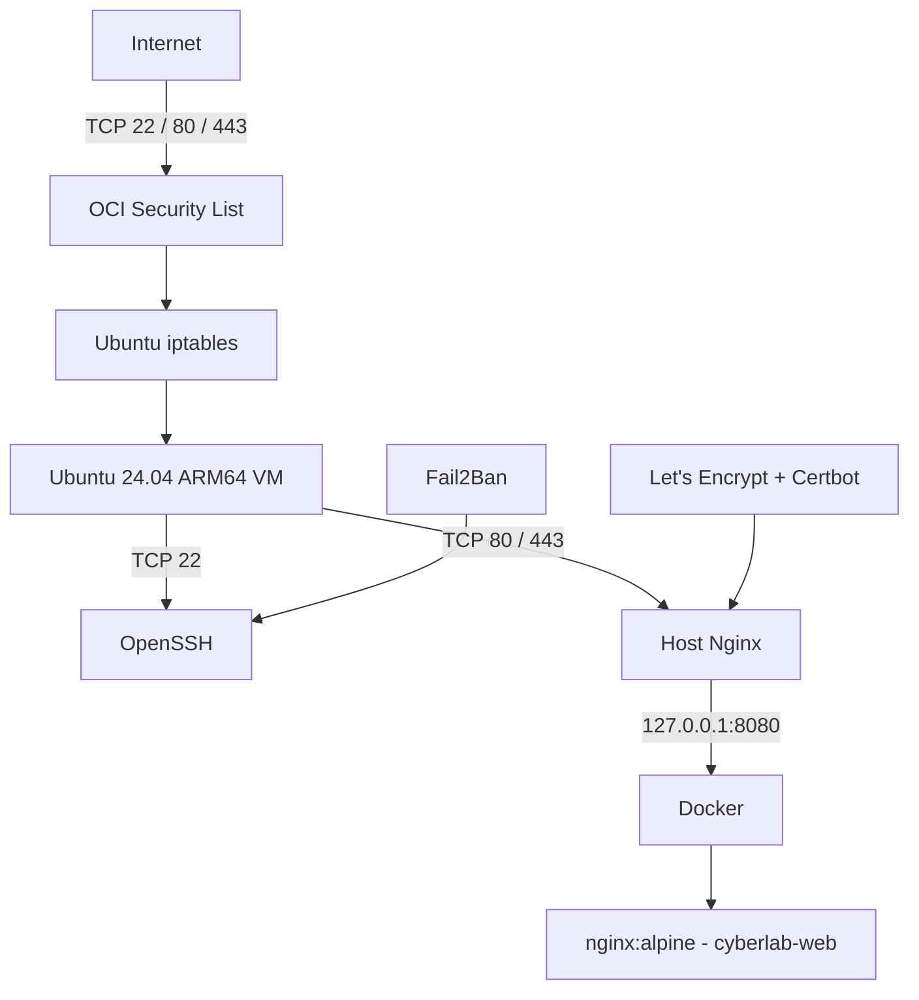

# OCI Cloud Security Lab

A hands-on cloud security project built on **Oracle Cloud Infrastructure (OCI)** to practice cloud networking, Linux hardening, firewalling, container isolation, reverse proxying, HTTPS, and security monitoring.

This repository documents the environment as it was actually built, including the troubleshooting and security decisions made along the way.

## Project goals

- Build a small security-focused cloud environment from scratch.
- Understand OCI networking instead of only following a deployment wizard.
- Harden a public Ubuntu server using SSH keys, host firewall rules, Fail2Ban, and automatic security updates.
- Keep the application container private and expose it through a host Nginx reverse proxy.
- Serve the public site over trusted HTTPS.
- Create documentation that can be explained in a junior cybersecurity or cloud interview.

## Current architecture



### OCI network

```text
VCN: 10.0.0.0/16
├── Public subnet:  10.0.0.0/24
│   └── cyberlab-server
└── Private subnet: 10.0.1.0/24
    └── reserved for future internal services
```

## Security controls implemented

- SSH public-key authentication.
- SSH password authentication disabled.
- Direct root SSH login disabled.
- OCI Security List controls cloud-level ingress.
- OCI Ubuntu `iptables` rules control host-level ingress.
- Only SSH, HTTP, and HTTPS are intentionally exposed.
- `rpcbind` disabled because NFS/RPC was not required.
- Fail2Ban SSH jail enabled.
- Automatic Ubuntu security updates enabled.
- Docker application bound only to `127.0.0.1:8080`.
- Host Nginx used as the public reverse proxy.
- HTTP redirects to HTTPS.
- Let's Encrypt renewal tested successfully with Certbot dry-run.

## External validation

The intended external scan is:

```text
22/tcp    open       ssh
80/tcp    open       http
443/tcp   open       https
8080/tcp  filtered   http-proxy
```

Port `8080` is deliberately not exposed to the internet. It is reachable only from localhost on the VM.

## Repository structure

```text
.
├── README.md
├── .gitignore
├── docs/
│   ├── 01-architecture.md
│   ├── 02-oci-networking.md
│   ├── 03-linux-hardening.md
│   ├── 04-firewall-security.md
│   ├── 05-docker-nginx.md
│   ├── 06-https-tls.md
│   └── troubleshooting.md
├── docker/
│   └── README.md
├── nginx/
│   └── cyberlab.conf.example
├── security/
│   ├── ssh-hardening.conf
│   ├── fail2ban-jail.local.example
│   └── iptables-rules.example
└── screenshots/
    └── README.md
```

## What I learned

This project connects several topics that are often learned separately:

- **Cloud networking:** VCNs, CIDR ranges, subnets, Internet Gateways, route tables, Security Lists, and public vs private IP addressing.
- **Linux security:** service exposure, SSH hardening, package updates, systemd services, and firewall rule ordering.
- **Defense in depth:** a port can be independently allowed or blocked at the OCI network layer and at the operating-system layer.
- **Containers:** the application can run in Docker without publishing its service directly to the internet.
- **Web security basics:** reverse proxying, TLS, certificate renewal, and limiting public attack surface.
- **Troubleshooting:** a service listening locally does not guarantee internet reachability.

## Security note

This repository intentionally does **not** contain private SSH keys, Let's Encrypt private keys, OCI API keys or tokens, complete OCI OCIDs, passwords, or other credentials.

## Roadmap

- [x] OCI compartment and VCN
- [x] Public/private subnets
- [x] Ubuntu ARM64 compute instance
- [x] SSH hardening
- [x] Host firewall hardening
- [x] Fail2Ban
- [x] Dockerized web application
- [x] Nginx reverse proxy
- [x] HTTPS with Let's Encrypt
- [ ] Centralized logging / monitoring dashboard
- [ ] OCI monitoring and alerting
- [ ] Additional private-subnet service
- [ ] Infrastructure as Code with Terraform
- [ ] Automated security checks

## Documentation

Start with [Architecture](docs/01-architecture.md), then follow the numbered documents in `docs/`.

---

Built as a practical cybersecurity and cloud-security learning project.