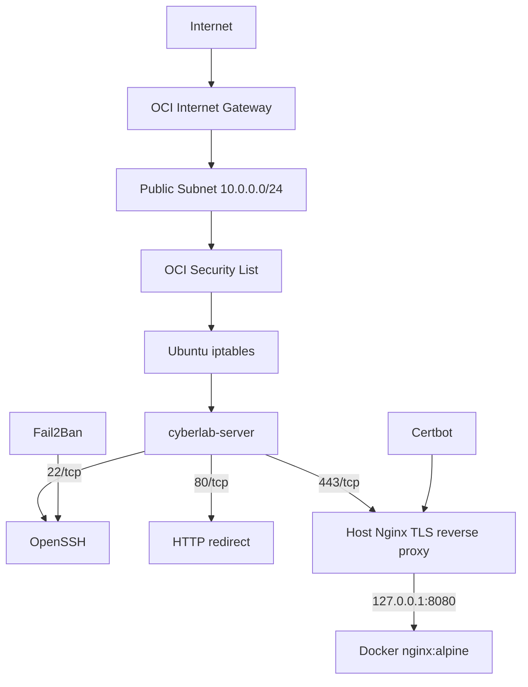

# Architecture

## Overview

The lab uses a public OCI compute instance as the controlled internet-facing entry point while keeping the Docker application itself bound to localhost.



## Compute

- OS: Canonical Ubuntu 24.04 LTS
- Architecture: ARM64 / `aarch64`
- OCI shape: `VM.Standard.A1.Flex`
- Resources used in the initial build: 1 OCPU and 6 GB RAM

## Network design

```text
cyberlab-vcn: 10.0.0.0/16
├── public subnet:  10.0.0.0/24
└── private subnet: 10.0.1.0/24
```

The server is placed in the public subnet because it needs a public IPv4 address for SSH and the web service. The private subnet is reserved for later internal services that should not accept direct inbound internet traffic.

## Public attack surface

Intentionally public:

- TCP/22 — SSH
- TCP/80 — HTTP, used for redirect and ACME HTTP validation
- TCP/443 — HTTPS

Intentionally private:

- TCP/8080 — Docker web container, bound to `127.0.0.1`

## Defense in depth

Traffic has to pass through multiple layers before reaching an application:

1. OCI Security List
2. Ubuntu host `iptables`
3. Service-specific configuration
4. Authentication or application controls

This design made it possible to observe that a locally listening service can still be unreachable from the internet if an upstream layer blocks the port.
